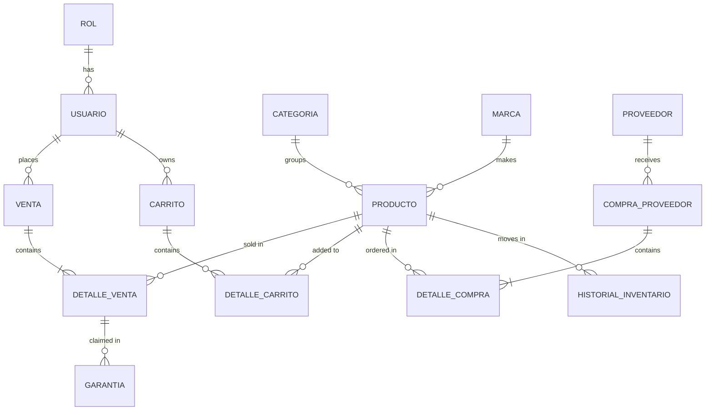

# TechStore Database (SQL Server / T-SQL)

Relational database for an electronics-store web app: catalog, customers, carts, sales,
supplier purchases, warranties, and an automatic inventory audit trail.

> 🎓 **University team project (databases course).** I designed and implemented the entire
> database layer. The C# web app that consumes it was built by the team and is **not included.**

## What's inside

| Object | Count | Notes |
|---|---|---|
| Tables | 14 | Master/detail pairs for sales, carts and supplier purchases |
| Stored procedures | 22 | CRUD, sale/purchase flows, warranties, catalog seed |
| Functions | 4 | Low-stock count, spend per user, best seller, warranty validity |
| Triggers | 3 | Stock deduction on sale, restock on cancellation and on supplier receipt |
| Views | 3 | Low stock, sales detail, inventory history |

## Design highlights

- **Inventory kept consistent by triggers**, with every movement logged in `HISTORIAL_INVENTARIO`.
- **Price frozen at sale time:** the procedure reads the current price from `PRODUCTO` and stores it in `DETALLE_VENTA`.
- **Soft delete** (`DEL_USUARIO`, `DEL_PRODUCTO`): records with history are deactivated instead of deleted.
- **Rules in the database, not only in the app:** `CHECK` constraints, a unique email, and a filtered unique
  index so a user can have only one active cart.
- **Error handling:** `TRY/CATCH` with transactions and `THROW` in the multi-step procedures.
- Passwords are stored as hashes generated by the application; the database never sees plain text.

## Entity-relationship diagram



*Overview generated from the foreign keys. Detailed design diagrams below.*

### Design diagrams

The design went from a conceptual model to a relational model:

- **Conceptual (E-R):** [part 1](docs/diagrams/er-diagram-part1.png) ·
  [part 2](docs/diagrams/er-diagram-part2.png) · [full](docs/diagrams/er-diagram-full.png)
- **Relational:** [relational diagram](docs/diagrams/relational-diagram.png)

Full column-level documentation: [`docs/data-dictionary.md`](docs/data-dictionary.md).

## Getting started

Requires SQL Server 2016 SP1 or later (`CREATE OR ALTER`). Run the scripts **in order**
(SSMS, Azure Data Studio or `sqlcmd`):

```text
sqlserver/00_create_database.sql
sqlserver/01_tables.sql
sqlserver/02_procedures.sql
sqlserver/03_functions.sql
sqlserver/04_triggers.sql
sqlserver/05_indexes.sql
sqlserver/06_views.sql
sqlserver/07_seed.sql
```

Then run `sqlserver/08_demo_tests.sql`. It exercises sales, cancellations, supplier purchases and
functions, and prints `PASS` / `FAIL` per check. To start over locally: `99_reset_dev_drop_database.sql` (destructive).

Tested on: **SQL Server 2022 Express Edition (16.0.1200.5) on Windows 10 Pro**

## Oracle version

[`oracle/techstore_oracle.sql`](oracle/techstore_oracle.sql) is the original PL/SQL version. It is **not
maintained** and has not been re-tested since the migration. What changed between engines, and the pitfalls
I found along the way, is documented in
[`docs/oracle-to-sqlserver-migration.md`](docs/oracle-to-sqlserver-migration.md).

## Known limitations

- **A sale isn't atomic by itself:** the header (`NEW_VENTA`) and each line (`NEW_DETALLE_VENTA`) are separate
  calls. If a line fails (e.g. insufficient stock), the header and earlier lines remain unless the caller wraps
  the whole checkout in one transaction.
- **No state-transition rules:** e.g. a cancelled sale can be set back to `Completada` without re-discounting stock.
- **Concurrency:** the stock check isn't locked; two simultaneous sales could both pass it. The `CHECK (STOCK >= 0)`
  constraint is the safety net (the second one fails with a constraint error, not the friendly message).
- **Warranty window** (`FN_GARANTIA_VIGENTE`) exists but `NEW_GARANTIA` doesn't enforce it.
- Tests are a single demo script, not an automated framework.

## Tech

SQL Server · T-SQL · (original: Oracle PL/SQL) · Mermaid for diagrams

## Notes
Original database design and implementation by me. Code review, trigger fixes,
demo tests and documentation were done with AI assistance (Claude).
